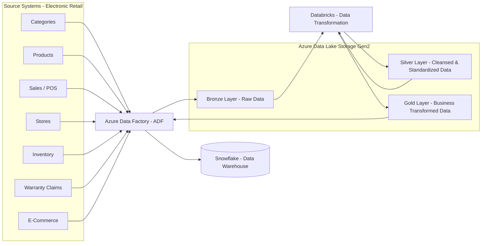

# Retail Data Engineering Project – Electronic Stores

## Business Scenario

A company sells electronic products across multiple stores and online channels.

1. **Online Stores (E-Commerce):** Online product sales and customer transactions.
2. **Store Operations (POS):** Sales transactions from physical retail stores.
3. **Product Management (Inventory System):** Product details and inventory management.
4. **Warranty Services:** Warranty registrations, claims, and service records.

## Data Formats

Data is stored in multiple systems and different formats.

- **CSV Files:** Sales, Products, Stores, Categories, Inventory.
- **Databases:** ERP, CRM, Operational Systems.
- **SaaS Applications:** CRM, E-Commerce.
- **Files / Logs:** System Logs, Event Data.
- **Web APIs:** External Data.

## Common Data Issues

Source data is not always analytics-ready.

- Duplicate records.
- Missing values.
- Inconsistent column names.
- Different date formats (DD/MM/YYYY, MM-DD-YYYY).
- Inconsistent data types.
- Invalid or incorrect data.

## Business Requirements

- How much revenue are we generating?
- Which products sell the most?
- Which stores perform better?
- How are sales changing over time?
- Which products have warranty claims?
- Which products are frequently out of stock?

## What We Will Do

- Build and maintain data pipelines.
- Ingest data from multiple source systems.
- Store data in a scalable data lake.
- Clean, transform, and enrich data.
- Perform data quality checks.
- Make data available for analytics and business use.

## How We Will Do It

## Architecture of the Project

### Data Flow

`Source Systems → ADF → ADLS Gen2 Bronze → Databricks → ADLS Gen2 Silver → Databricks → ADLS Gen2 Gold → ADF → Snowflake`